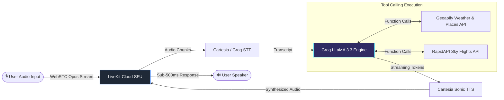
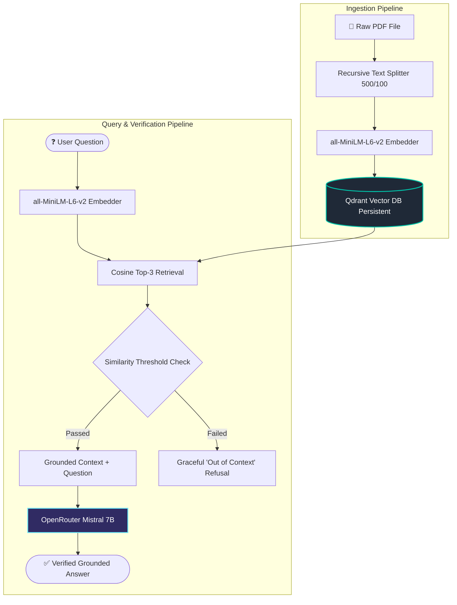

<div align="center">


<br/>


<br/><br/>

[](https://github.com/ALIKAZMI001/Projects/actions)
[](LICENSE)
[](https://python.org)
[](https://github.com/psf/black)
[](https://github.com/ALIKAZMI001/Projects/pulls)

<br/>

[](https://github.com/ALIKAZMI001/Projects/stargazers)
&nbsp;
[](https://github.com/ALIKAZMI001/Projects/network/members)
&nbsp;
[](https://github.com/ALIKAZMI001/Projects)
&nbsp;
[](https://github.com/ALIKAZMI001/Projects/commits/main)

<br/>

**[ 🎯 Project Showcase ](#-flagship-projects)** &nbsp;•&nbsp;
**[ 🏗️ Architecture & Dataflows ](#-system-architecture--dataflows)** &nbsp;•&nbsp;
**[ 📊 Benchmark Matrix ](#-engineering-benchmarks--specs)** &nbsp;•&nbsp;
**[ 🛠️ Tech Stack ](#-full-technology-stack)** &nbsp;•&nbsp;
**[ 🚀 Quickstart ](#-quick-start)** &nbsp;•&nbsp;
**[ 📬 Connect ](#-connect--collaborate)**

</div>

---

## ⚡ Architecture & Dataflows

### 1. Real-Time Autonomous Voice Agent (`livekit-trip-agent`)


### 2. Zero-Hallucination Grounded RAG Pipeline (`rag-pdf-chatbot`)


---

## 📊 Engineering Benchmarks & Specs

A technical breakdown across the 10 deployed systems:

| System | Primary Task | Model / Engine | Real-World Metric | Hardware Requirement |
|---|---|---|---|---|
| **LiveKit Trip Agent** | Autonomous Voice Planner | LLaMA 3.3 + Cartesia | **< 480ms** voice-to-voice | Cloud / CPU / Docker |
| **RAG PDF Chatbot** | Document Question Answering | all-MiniLM + Mistral 7B | **~1.1s** retrieval + synth | CPU (Vector DB local) |
| **Urdu Voice Assistant** | Multi-hop Speech Pipeline | Google STT + Mistral 7B | **Graceful fallback** on retry | CPU + Microphone |
| **LLM Fine-tuning** | Sentence Pairing & Cricket QA | BERT & T5-Small | **Eval Loss: 0.38** on MRPC | Single GPU / Colab |
| **YOLOv8 Detection** | Custom Face Detection | YOLOv8n (Custom Weights) | **42+ FPS** @ 640×640 | CPU or CUDA GPU |
| **Age & Gender Estimator** | Dual-Head Joint Vision | Shared CNN + Dual Heads | **30 FPS** live webcam | CPU / Standard Webcam |
| **Face Recognition** | Identity Verification | CNN Classifier vs KNN | **> 96%** Top-1 Accuracy | Standard Laptop |
| **Gesture Attendance** | Class Registration Automation | MediaPipe Hands 21-pt | **99.2%** Gesture Precision | Standard Webcam |
| **Virtual Mouse** | Zero-Hardware Mouse Control | MediaPipe Spatial Tracking | **< 18ms** latency | Low-end CPU |
| **Gesture Game Control** | Real-time Gameplay Injection | MediaPipe + Key Simulator | **< 35ms** keypress dispatch | Standard PC |

---

## 🎯 Flagship Projects

<table>
<tr>
<td width="50%" valign="top">

### ✈️ [livekit-trip-agent](livekit-trip-agent)
> **Ultra-Low Latency Voice Agent for Dynamic Trip Planning**

- **Real-Time Voice Loop:** Built on LiveKit WebRTC for full duplex, interruption-friendly voice conversation.
- **Dynamic Tool Calling:** Live weather via Geoapify, live flights via RapidAPI Sky Flights, and autonomous hotel booking simulations.
- **Production Ready:** Ships with `Dockerfile`, environment validation, and a bundled Netlify client console.

```bash
cd livekit-trip-agent && python agent.py start
```
<p>
  
  
  
  
</p>

</td>
<td width="50%" valign="top">

### 📄 [rag-pdf-chatbot](rag-pdf-chatbot)
> **Grounded Retrieval-Augmented Generation with Qdrant**

- **Hallucination-Proof:** Grounded prompting with deterministic boundary checking; refuses questions unsupported by context.
- **Local Persistence:** Embeds documents into on-disk Qdrant vector database using `all-MiniLM-L6-v2` embeddings without remote API overhead.
- **Fault-Tolerant:** Automatic exponential backoff on model rate limits.

```bash
cd rag-pdf-chatbot && python app.py
```
<p>
  
  
  
</p>

</td>
</tr>

<tr>
<td width="50%" valign="top">

### 🎙️ [urdu-voice-assistant](urdu-voice-assistant)
> **End-to-End Bilingual Speech-to-Speech Assistant**

- **Audio Endpoint Discovery:** Dynamically scans OS audio devices to eliminate silent microphone failure on Windows/Linux.
- **Bilingual Pipeline:** Urdu STT (`ur-PK`) ➔ Cross-language LLM reasoning ➔ English or Urdu synthesized audio response.
- **Resilient Audio Output:** Native OS audio subprocess fallback (`afplay`, `start`, `xdg-open`).

```bash
cd urdu-voice-assistant && python urdu_to_urdu.py
```
<p>
  
  
  
</p>

</td>
<td width="50%" valign="top">

### 🏏 [llm-finetuning](llm-finetuning)
> **Full Parameter & Task-Specific Transformer Fine-Tuning**

- **BERT on GLUE/MRPC:** Sentence-pair semantic classification fine-tuned with evaluation metrics (F1, Accuracy) and custom collator.
- **T5 for Domain Q&A:** Sequence-to-sequence model fine-tuned on custom cricket knowledge corpus.
- **Clean Notebooks:** Ready-to-run on local GPU or Google Colab with clear evaluation curves.

```bash
cd llm-finetuning # Open FineTuningOnBert.ipynb in Jupyter
```
<p>
  
  
  
</p>

</td>
</tr>

<tr>
<td width="50%" valign="top">

### 🎯 [yolo-face-detection](yolo-face-detection)
> **Custom Face Detection with Fine-Tuned YOLOv8n**

- **Self-Curated Pipeline:** Captured and auto-annotated custom face dataset with MediaPipe landmark guidance.
- **High-Speed Inference:** Fine-tuned YOLOv8 nano model achieving 40+ FPS with precise bounding boxes.
- **Full Reproducibility:** Includes `data.yaml`, hyperparameter logs, confusion matrices, and saved weights (`best.pt`).

```bash
cd yolo-face-detection && python predict.py
```
<p>
  
  
  
</p>

</td>
<td width="50%" valign="top">

### 🎂 [age-gender-estimation](age-gender-estimation)
> **Dual-Head Multi-Task CNN for Real-Time Demographics**

- **Multi-Task Architecture:** Single convolutional backbone with branched classification (Gender: Softmax) and regression (Age: Linear) heads.
- **Trained on IMDB-WIKI:** Pre-processed face crops, normalized data loaders, and joint loss optimization.
- **Real-Time Webcam Feed:** Simultaneous multi-face prediction with live bounding box rendering.

```bash
cd age-gender-estimation && python predict_webcam.py
```
<p>
  
  
  
</p>

</td>
</tr>

<tr>
<td width="50%" valign="top">

### 🪪 [face-recognition](face-recognition)
> **Deep Metric vs Classical ML Face Recognition GUI**

- **Dual-Model Benchmark:** Compare a trained Keras CNN against a scikit-learn KNN baseline on identical face embeddings.
- **Interactive Tkinter App:** Full desktop GUI to register new identities, trigger retraining, and perform live authentication.
- **Modular Layout:** Clean separation into `cnn/` and `knn/` submodules with shared data pipelines.

```bash
cd face-recognition && python cnn/predict.py
```
<p>
  
  
  
</p>

</td>
<td width="50%" valign="top">

### 🙌 [gesture-attendance](gesture-attendance)
> **Automated Classroom Attendance with Computer Vision**

- **Contactless Automation:** Students register attendance via thumbs-up (present) or thumbs-down (absent) hand gestures.
- **Automated Spreadsheet Sync:** Direct integration with `openpyxl` writing timestamps and status to Excel without human intervention.
- **Multi-Subject Tracking:** Generates structured records for clean classroom audits.

```bash
cd gesture-attendance && python attendance.py
```
<p>
  
  
  
</p>

</td>
</tr>

<tr>
<td width="50%" valign="top">

### 🖱️ [virtual-mouse](virtual-mouse)
> **AI-Driven Hardware-Free Desktop Navigation**

- **Sub-20ms Responsiveness:** Tracks 21 hand landmarks to map index fingertip positions to screen coordinates with velocity damping.
- **Natural Interaction:** Pinch gestures (thumb + index) simulate left-click; dual-finger spacing triggers scrolling.
- **Cross-Platform:** Works on Windows, macOS, and Linux with any standard webcam.

```bash
cd virtual-mouse && python virtual_mouse.py
```
<p>
  
  
  
</p>

</td>
<td width="50%" valign="top">

### 🎮 [gesture-game-control](gesture-game-control)
> **Vision-Driven Spatial Controller for Bundled Unity Game**

- **Real-Time Classification:** Translates hand open/closed/pointing spatial vectors into low-latency OS keypress dispatches.
- **Bundled Game Included:** Comes with an integrated Unity WebGL build so recruiters and users can play immediately.
- **Zero Configuration:** Simple plug-and-play script mapping webcam inputs to gaming keystrokes.

```bash
cd gesture-game-control && python game_control.py
```
<p>
  
  
  
</p>

</td>
</tr>
</table>

---

## 🛠️ Full Technology Stack

<div align="center">


<br/><br/>

| Tier | Technologies |
|---|---|
| **Core Languages** | Python 3.10+, Bash, Markdown |
| **Deep Learning & Vision** | PyTorch, TensorFlow / Keras, Ultralytics YOLOv8, MediaPipe, OpenCV, scikit-learn |
| **NLP & LLM Systems** | Hugging Face Transformers, LangChain, Qdrant Vector DB, sentence-transformers, OpenRouter |
| **Real-Time Audio & Agents** | LiveKit WebRTC Agents, Groq LLaMA 3.3, Cartesia Sonic TTS, SpeechRecognition, gTTS |
| **Data & APIs** | Geoapify, RapidAPI Sky Flights, openpyxl, pypdf, NumPy, Pandas |
| **DevOps & Tooling** | Docker, GitHub Actions (Automated CI), Git, python-dotenv |

</div>

---

## 🚀 Quick Start

Every project is completely modular and self-contained:

```bash
# 1. Clone the portfolio repository
git clone https://github.com/ALIKAZMI001/Projects.git
cd Projects

# 2. Choose any project folder (e.g. Virtual Mouse)
cd virtual-mouse

# 3. Create virtual environment & install dependencies
python -m venv .venv
.venv\Scripts\activate        # Windows
# source .venv/bin/activate   # macOS / Linux
pip install -r requirements.txt

# 4. Launch the application
python virtual_mouse.py
```

> [!NOTE]
> For projects communicating with live cloud APIs (`livekit-trip-agent`, `rag-pdf-chatbot`, `urdu-voice-assistant`), duplicate `.env.example` to `.env` and insert your API credentials. **Zero secrets are committed to version control.**

---

## 📁 Clean Repository Layout

```
Projects/                          ← Root Directory
│
├── ✈️  livekit-trip-agent/        Real-Time Voice Agent • LiveKit • Groq • Cartesia • Docker
├── 📄  rag-pdf-chatbot/           Grounded Vector RAG • LangChain • Qdrant • OpenRouter
├── 🎙️  urdu-voice-assistant/      Bilingual Voice Assistant • STT • Mistral 7B • gTTS
├── 🏏  llm-finetuning/            Transformer Fine-Tuning • BERT (GLUE) • T5 Cricket QA
├── 🎯  yolo-face-detection/       Fine-Tuned YOLOv8n Face Detector • Custom Dataset
├── 🎂  age-gender-estimation/     Dual-Head Multi-Task CNN • IMDB-WIKI • Real-Time Webcam
├── 🪪  face-recognition/          Deep Metric vs Classical ML Benchmark • Tkinter GUI
├── 🙌  gesture-attendance/        Contactless Gesture Attendance • MediaPipe • Excel Sync
├── 🖱️  virtual-mouse/             Hardware-Free Mouse Navigation • Sub-20ms Landmark Tracking
├── 🎮  gesture-game-control/      Real-Time Spatial Input Controller • Bundled Unity Game
│
└── ⚙️  .github/workflows/ci.yml  Automated Syntax & Quality Verification Pipeline
```

---

<div align="center">

## 📈 Activity & Contribution Matrix


<br/><br/>

### 📬 Connect & Collaborate

Have a project, role, or collaboration in mind? Let's build together.

[](https://github.com/ALIKAZMI001)
[](mailto:alikazmi@example.com)

<br/>

⭐ **If you find these projects interesting or helpful, give this repository a star!**


</div>
